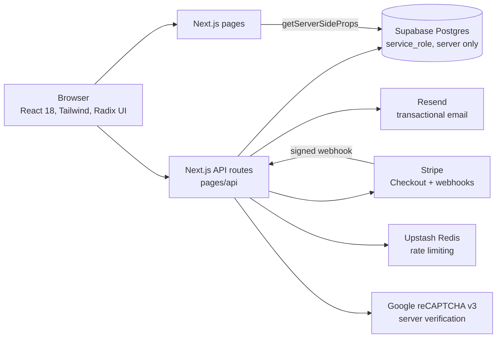
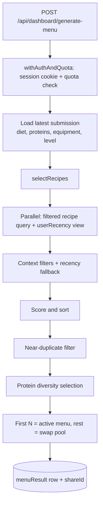

# Quinoia

Quinoia is a French meal-planning web app. A user fills in a short questionnaire (diet, preferred protein sources, kitchen equipment, cooking level, number of recipes and servings) and receives a weekly menu of quick recipes with an aggregated shopping list. Recipes can be swapped from a pre-selected pool, and the menu can be shared through a public link. A paid plan unlocks unlimited swaps and a larger swap pool.

Live: [quinoia.fr](https://quinoia.fr). The interface is in French, and payments run in Stripe test mode (no real charges).

## Features

- Multi-step questionnaire, then a weekly menu sent by email with a sign-in link ([pages/formulaire.jsx](pages/formulaire.jsx), [pages/api/submit.ts](pages/api/submit.ts))
- Passwordless sign-in by magic link ([pages/api/auth/](pages/api/auth/))
- Dashboard with current menu, history and profile/preferences ([pages/dashboard/index.tsx](pages/dashboard/index.tsx))
- Recipe swaps from a swap pool, with pool refetch when it runs out ([src/hooks/useMenuSwap.ts](src/hooks/useMenuSwap.ts), [pages/api/dashboard/menu/[id]/refetch-pool.ts](pages/api/dashboard/menu/[id]/refetch-pool.ts))
- Shopping list scaled to the number of servings, grouped by supermarket section, copyable to the clipboard ([src/lib/recipes/services/shoppingListService.ts](src/lib/recipes/services/shoppingListService.ts), [src/components/dashboard/ShoppingListDrawer.tsx](src/components/dashboard/ShoppingListDrawer.tsx))
- Public share page per menu, served with `noindex` ([pages/menu/[shareId].tsx](pages/menu/[shareId].tsx))
- Free tier: one menu per rolling 7-day window and one swap per menu; paid tier: unlimited swaps and a 10-recipe swap pool. All tiers: one menu per calendar week, enforced by a unique index ([src/lib/quotas/checker.ts](src/lib/quotas/checker.ts))
- Monthly and yearly subscriptions through Stripe Checkout ([pages/tarifs.tsx](pages/tarifs.tsx), [pages/api/checkout/create-session.ts](pages/api/checkout/create-session.ts))

## Architecture

Next.js 15 (Pages Router) serves both the UI and the API routes. The browser never queries the database: every Supabase query runs on the server (API routes, and `getServerSideProps` for the public share page) through a server-only client (recipe images are served from Supabase Storage through public or signed URLs, [src/lib/supabase/storage.ts](src/lib/supabase/storage.ts)).



Menu generation flow (dashboard):



Main stack ([package.json](package.json)): Next.js 15.4.5, React 18.2, TypeScript 5.9, Tailwind CSS, Radix UI, framer-motion, Zod 4, Supabase JS, Stripe, Resend, Upstash Ratelimit.

## How menu generation works

Menu generation is rule-based and deterministic for a given input; it does not call a language model. The entry point is [pages/api/dashboard/generate-menu.ts](pages/api/dashboard/generate-menu.ts), which calls `selectRecipes` in [src/lib/recipes/recipeSelector.ts](src/lib/recipes/recipeSelector.ts).

1. **Candidate query.** Active recipes compatible with the user's diet (an omnivore also gets flexitarian and vegetarian recipes, a vegetarian also gets vegan ones), with a preparation time of 30 minutes or less and, when set, a minimum protein per serving, minus any excluded IDs ([src/lib/supabase/repositories/recipes.ts](src/lib/supabase/repositories/recipes.ts)). The recency data is fetched in parallel from the `userRecency` view ([src/lib/supabase/recency.ts](src/lib/supabase/recency.ts)).
2. **Context filters.** Every required piece of equipment must be available (a pan and a pot are assumed), the recipe level must not exceed the user's level, and the protein category must match the user's preferences when there are any.
3. **Recency with progressive fallback.** Recipes that appeared in the user's menus in the last 21 days are excluded. If fewer than 15 recipes remain, recipes last seen more than 14 days ago are re-included, then more than 7 days ago, then all of them.
4. **Scoring.** Each recipe receives a sum of: +1 if its protein category is preferred; 0.8 × protein grams per 100 kcal; +0.5 for batch-friendly recipes when batch mode is on; +1 per favourite-food word and -3 per disliked-food word found in the title, tags or ingredients; and a freshness term (-2 if seen in the last 7 days, 0 for 8 to 14 days, +0.5 for 15 to 21 days or not seen in the window). Ties are broken by protein content, then by recipe ID.
5. **Near-duplicate filter.** A similarity score combines ingredient overlap (Jaccard), title-token overlap, a shared base dish and protein, and a shared cooking pattern. Lower-scored recipes with a similarity of 0.7 or more to a kept recipe are dropped, unless that would remove more than 40% of the pool.
6. **Diversity.** One recipe per preferred protein category is picked first, then the remaining slots rotate round-robin through a diet-specific protein order (for example Beef, Poultry, Meat alternatives, Fish, Eggs, Dairy, Legumes, Tofu for omnivores).

The route asks for the number of menu recipes plus a swap pool (3 for free users, 10 for paid users, [src/lib/constants/recipeSelection.ts](src/lib/constants/recipeSelection.ts)), keeps the first N as the menu and stores the rest as the pool. A unique index on user and calendar week rejects a second menu in the same week ([supabase/migrations/20251027000000_baseline_production_schema.sql](supabase/migrations/20251027000000_baseline_production_schema.sql)).

When the pool is refetched, recipes already in the menu and recipes the user removed (`removedRecipeIds`) are excluded. If fewer than 10 recipes are found, the route retries without protein preferences or protein floor; if none are found, it clears the removed list to start a new cycle ([pages/api/dashboard/menu/[id]/refetch-pool.ts](pages/api/dashboard/menu/[id]/refetch-pool.ts)).

Both entry points pass diet, protein preferences, equipment and cooking level. The public questionnaire ([pages/api/submit.ts](pages/api/submit.ts)) also passes batch mode, favourite and disliked foods and a protein floor of 20 g per serving; the dashboard routes use the protein floor stored with the submission.

## Engineering highlights

**Security**

- Server-only database access: [src/lib/supabase/client.ts](src/lib/supabase/client.ts) throws if it is imported in the browser and creates the client with the service_role key.
- Database hardening: [supabase/migrations/20261120000000_harden_rls.sql](supabase/migrations/20261120000000_harden_rls.sql) enables row-level security on every public table, switches the views to `security_invoker`, and revokes all direct table grants (including default privileges for tables created by the migration role) from the `anon` and `authenticated` roles.
- Magic-link authentication with its own session table: tokens are random UUIDs, links expire after 15 minutes and can be used once, sessions last 30 days in an `HttpOnly; Secure; SameSite=Strict` cookie ([src/lib/auth/tokens.ts](src/lib/auth/tokens.ts), [pages/api/auth/verify-magic-link.ts](pages/api/auth/verify-magic-link.ts), [src/lib/auth/session.ts](src/lib/auth/session.ts)). Dashboard routes are wrapped in [src/middleware/withAuth.ts](src/middleware/withAuth.ts) and [src/middleware/withQuotaCheck.ts](src/middleware/withQuotaCheck.ts).
- Rate limiting with Upstash (token bucket): 3 magic-link requests per email per hour, 5 checkout sessions per IP per minute ([src/lib/auth/rateLimits.ts](src/lib/auth/rateLimits.ts), [pages/api/auth/request-magic-link.ts](pages/api/auth/request-magic-link.ts), [pages/api/checkout/create-session.ts](pages/api/checkout/create-session.ts)). Without Upstash credentials the limiter runs in no-op mode.
- reCAPTCHA v3 is verified server-side with a minimum score of 0.5 on the public questionnaire ([src/lib/auth/recaptcha.ts](src/lib/auth/recaptcha.ts)).
- Stripe webhooks read the raw body and verify the `stripe-signature` header with `stripe.webhooks.constructEvent` before handling any event ([pages/api/webhooks/stripe.ts](pages/api/webhooks/stripe.ts), [src/lib/stripe/server.ts](src/lib/stripe/server.ts)).
- Share IDs are 12 random bytes, base64url-encoded ([pages/api/dashboard/generate-menu.ts](pages/api/dashboard/generate-menu.ts)).

**Validation**

- Server environment variables are validated with Zod when the config module loads; a missing or malformed required variable throws an error listing every problem ([src/lib/config/env.ts](src/lib/config/env.ts)).
- The questionnaire, onboarding, auth and menu routes validate their input with Zod schemas, with French error messages ([src/schemas/](src/schemas/), [src/schemas/zodErrorMap.fr.ts](src/schemas/zodErrorMap.fr.ts), [pages/api/onboarding/submit.ts](pages/api/onboarding/submit.ts)).

**Observability**

- Structured JSON logger with a run ID (route handlers create one per request and return it in `X-Run-ID`), automatic PII redaction of every log context (emails, IPv4 addresses, prefixed tokens, URLs with secrets) and hash-based sampling of debug logs ([src/lib/logger/](src/lib/logger/)).

**Testing**

- Vitest with happy-dom, MSW and jest-dom matchers for unit tests ([vitest.config.ts](vitest.config.ts), [src/tests/setupTests.ts](src/tests/setupTests.ts)): 15 files under [src/tests/](src/tests/) (outside `integration/` and `e2e/`) covering Stripe configuration and webhook handlers, shopping-list generation, portion scaling, recency, IP detection, quotas and schemas.
- 13 integration test files run against a local Supabase stack: onboarding scenarios per user status, magic-link auth, Stripe webhook security, database access and the logger ([src/tests/integration/](src/tests/integration/)).
- Playwright smoke and checkout tests ([src/tests/e2e/](src/tests/e2e/), [playwright.config.ts](playwright.config.ts)).

## How it was built

Quinoia is a solo project: product, design decisions, architecture and code. Changes were merged through pull requests on the original private repository (numbered up to #14); commit subjects ending in `(#N)` reference them.

The code was written with AI coding agents working under explicit conventions. [AGENTS.md](AGENTS.md) defines the architecture rules, the implementation steps (schemas first, then logic, API routes and UI), the validation protocol (tests and production build) and a self-evaluation checklist the agent is asked to go through before a change is considered done. Some commits carry `Co-authored-by` trailers for GitHub Copilot and Claude.

## Getting started

Prerequisites: Node.js and npm, a Supabase project (or the Supabase CLI for a local stack), and Stripe, Resend and reCAPTCHA v3 test credentials. Upstash is optional.

```bash
npm ci
cp .env.example .env.local   # then fill in the values
npm run dev                  # http://localhost:3000
```

All variables are listed and commented in [.env.example](.env.example). The required server variables are validated by [src/lib/config/env.ts](src/lib/config/env.ts).

Database: `npx supabase start` (or `npx supabase db reset`) applies the migrations in [supabase/migrations/](supabase/migrations/), a baseline of the production schema followed by the RLS hardening and later fixes, then loads the recipes and ingredients from [supabase/seed.sql](supabase/seed.sql), generated from [supabase/data/](supabase/data/). The earlier hand-applied migrations are kept for reference in [supabase/migrations_archive/](supabase/migrations_archive/).

Other commands:

```bash
npm run lint
npm run build

# Unit tests (no database needed)
npx vitest run --exclude 'src/tests/integration/**'

# Integration tests: local Supabase stack, .env.local.test, and a dev server
# started with INTEGRATION_TESTS=true (see src/tests/integration/README.md)
npx supabase start
npx cross-env INTEGRATION_TESTS=true npm run dev   # separate terminal
npm run test:integration

# E2E tests: Playwright against a running dev server
npm run dev
npm run e2e                   # PLAYWRIGHT_BASE_URL defaults to http://localhost:3000
```

## Repository layout

```
pages/                 Next.js pages and API routes (pages/api)
src/components/        UI: questionnaire steps, dashboard, shared UI
src/hooks/             Client hooks (menu swaps, progress)
src/lib/auth/          Magic links, sessions, reCAPTCHA, rate limiting
src/lib/recipes/       Recipe selection and shopping list
src/lib/supabase/      Server-only Supabase client and repositories
src/lib/stripe/        Stripe configuration and server helpers
src/lib/email/         Resend client and email templates
src/lib/logger/        Structured logger with redaction and sampling
src/lib/quotas/        Free and paid usage quotas
src/lib/config/        Zod-validated environment
src/schemas/           Zod request and data schemas
src/tests/             Unit, integration and E2E tests
supabase/              SQL migrations and seed data
docs/                  Specifications, UX flows, setup notes
AGENTS.md              Conventions for AI coding agents
```
