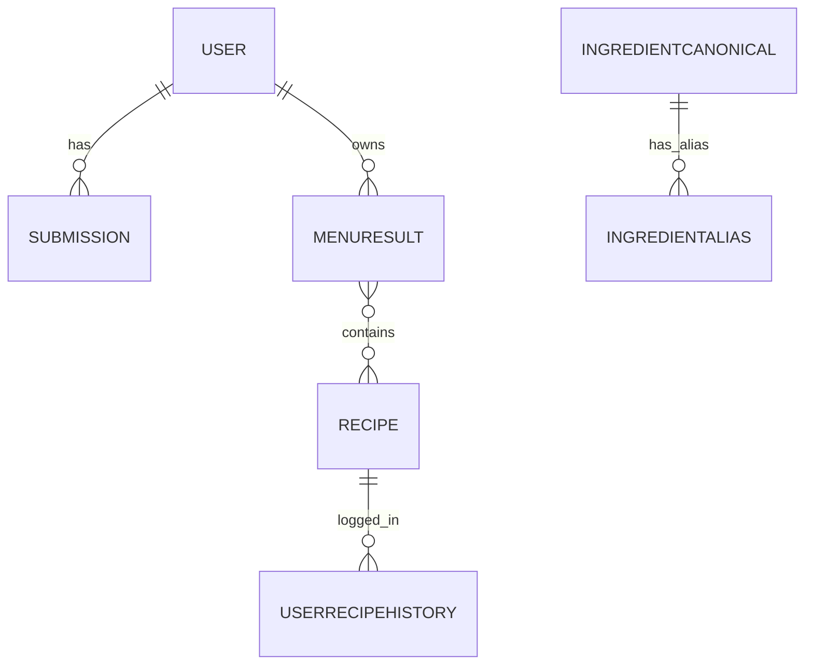
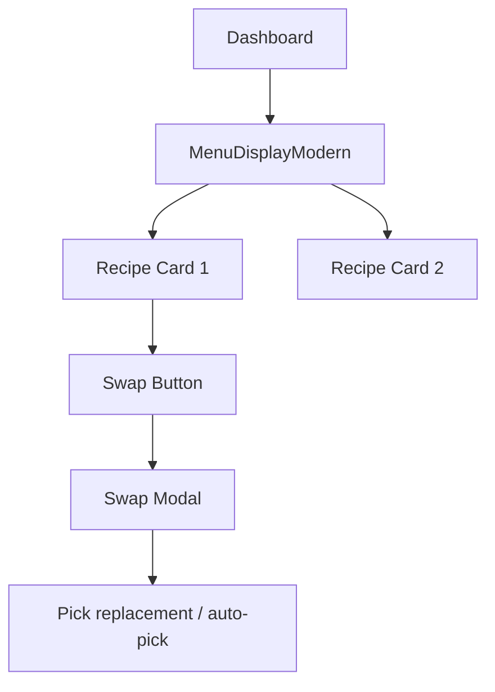
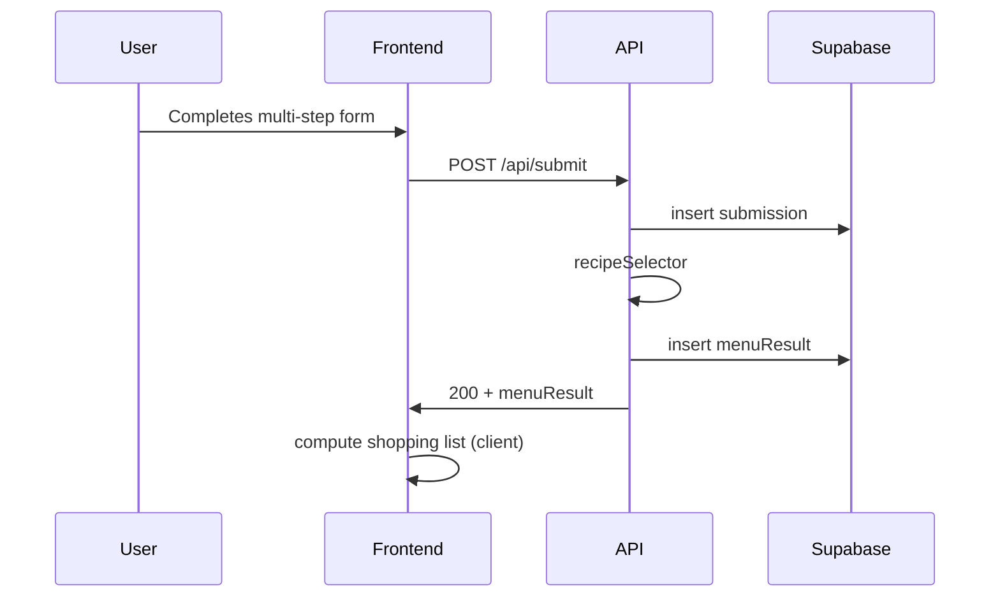
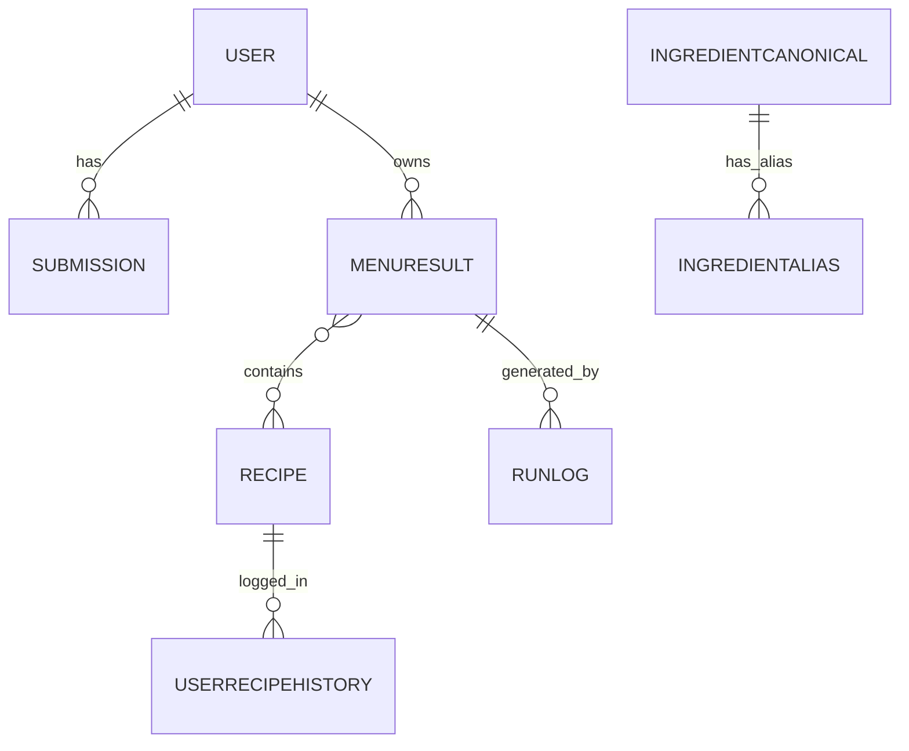

# Spécifications fonctionnelles et techniques — Quinoïa

Date: 2025-10-19

Ce document rassemble les spécifications fonctionnelles et techniques complètes du projet Quinoïa. Il est destiné aux développeurs, designers produit, QA et aux équipes d'exploitation.

Table des matières
1. Contexte et objectifs
2. Périmètre fonctionnel (fonctionnalités détaillées)
   - 2.1 Acteurs & rôles
   - 2.2 Feature list détaillée
     - 2.2.1 Génération de menu
     - 2.2.2 Liste de courses (shopping list)
     - 2.2.3 Swap de recettes
     - 2.2.4 Dashboard utilisateur (gestion recettes, historique)
     - 2.2.5 Onboarding & formulaire initial
     - 2.2.6 Partage de menu
     - 2.2.7 Autres (profil, préférences)
   - 2.3 Différences Free vs Premium
3. Flux utilisateurs (user journeys)
4. API et contrats (endpoints, payloads, erreurs)
5. Schéma de données (Supabase) — ER & description des tables
6. Comportement détaillé des fonctions critiques
   - 6.1 Générateur de menu
   - 6.2 Swap (pool, limites, comptage)
   - 6.3 Calcul liste de courses
7. Authentification & sécurité
8. Paiements & Stripe (abonnements)
9. Tests, couverture & stratégie QA
10. Observabilité & monitoring
11. Déploiement & environnements
12. Wireframes & diagrammes (Mermaid)
13. Annexes

---

## 1. Contexte et objectifs

Quinoïa propose de générer des menus hebdomadaires personnalisés à partir des préférences alimentaires de l'utilisateur, puis de fournir une liste de courses et des outils pour ajuster le menu (swap, suppression/ajout de recettes). Le produit cible des utilisateurs francophones. Le code est en anglais mais l'interface est en français.

Objectifs de ce document:
- Lister toutes les fonctionnalités existantes et prévues.
- Décrire précisément le comportement pour les utilisateurs free et premium.
- Documenter l'architecture technique : API, DB (Supabase), intégrations (Stripe), sécurité, tests.
- Fournir wireframes et diagrammes pour faciliter l'implémentation et la QA.

## 2. Périmètre fonctionnel (fonctionnalités détaillées)

### 2.1 Acteurs & rôles

- Visiteur anonyme: peut voir pages publiques (landing, tarifs, FAQ). Peut initier onboarding mais doit se connecter pour sauver des préférences.
- Utilisateur inscrit (Free): accès restreint, fonctionnalités principales limitées (nombre de recettes, taille du swap pool, certaines options premium désactivées).
- Utilisateur Premium (abonné via Stripe): accès étendu (plus de recettes, pool swap plus grand, export/partage avancé, historique plus long, priorités de performance si applicable).
- Admin/Opérations: accès à la base de données, capacités de gestion de contenu (recettes), revues et modération.

### 2.2 Feature list détaillée

Chaque fonctionnalité est décrite avec: objectif, acteurs, flux, validations, erreurs attendues, métrique de succès.

#### 2.2.1 Génération de menu

- Objectif: Créer un menu hebdomadaire composé de N recettes (N choisi par l'utilisateur) adapté aux préférences (régime, allergies, protéines souhaitées, équipements disponibles, niveau de cuisine, portions).
- Acteurs: Utilisateurs inscrits (Free & Premium).
- Entrées: `submission` (rawFormJson/normalizedInput) ou préférences sauvegardées depuis le dashboard.
- Sortie: `menuResult.resultBundle` (JSON) stocké dans `menuResult`.
- Contraintes:
  - Vérifier RLS: menu accessible uniquement par owner sauf si `shareActive=true`.
  - Les free users peuvent demander 2–3 recettes (selon UI) ; premium jusqu'à 7.
  - Respecter allergies (exclusion d'ingrédients/recettes), préférences, équipements.
- Erreurs:
  - Input invalide -> 400 + payload d'erreur (forme `{ error, code, details }`).
  - Pas de recette disponible -> 422 + message d'alerte (backfill / fallback possible).

#### 2.2.2 Liste de courses (shopping list)

- Objectif: Fournir une liste d'ingrédients agrégée et normalisée pour le menu courant.
- Acteurs: Utilisateur lors de la consultation d'un `menuResult`.
- Comportement:
  - Calcul client-side via fonction pure `src/utils/shoppingList/generator.ts` (le commentaire indique que la shopping list n'est pas cachée dans DB).
  - Prise en compte du scaling des portions (`menuResult.numServings` vs `recipe.servingsBase`).
  - Normalisation des ingrédients via `ingredientCanonical` et `ingredientAlias`.
  - Option d'export (PDF, copy, print) — non implémentée dans le code actuel mais à spécifier.

#### 2.2.3 Swap de recettes

- Objectif: Permettre aux utilisateurs d'échanger une recette du menu par une alternative compatible.
- Acteurs: Utilisateurs inscrits.
- Mécanique:
  - `menuResult` garde `activeRecipeIds` et `swapPoolRecipeIds`.
  - Free users: swap pool pré-rempli de taille 1 ; premium: taille 10.
  - Quand utilisateur swap: mise à jour `menuResult.activeRecipeIds`, incrément `swapsCount` et `updatedAt`.
  - `hasSwappedInWindow` & `hasGeneratedInWindow` aident à limiter/monitorer actions dans une fenêtre temporelle.
- Règles:
  - SwapsCount incrémente ; aucune limite stricte pour l'instant sauf ce pool (design: on peut implémenter quotas si besoin).

#### 2.2.4 Dashboard utilisateur

- Sections principales détectées: Profil, Préférences (PreferencesForm), Historique (HistoriqueSection), MenuSection, ShoppingListDrawer, MenuDisplayModern.
- Fonctionnalités:
  - Visualiser dernier menu (menuResult) et historique (`userRecipeHistory`).
  - Swaps en ligne, suppression d'une recette, ajout possible (UX à définir sur ajout manuel).
  - Upsell pour premium (UpsellModals, PremiumUpgradeModal).

#### 2.2.5 Onboarding & formulaire initial

- Multi-step onboarding stocke `submission` et `normalizedInput`.
- Validations: zod schemas `src/schemas/normalizedInput.schema.ts` et `submitRequest.schema.ts` contrôlent la forme.
- reCAPTCHA: vérifié côté serveur (`src/lib/auth/recaptcha.ts`).

#### 2.2.6 Partage de menu

- `menuResult.shareId` permet l'accès public via route `/menu/[shareId]`.
- Politique SEO: la page devrait inclure `X-Robots-Tag: noindex` et meta robots noindex,nofollow (AGENTS.md).
- Comportement: `shareActive` boolean ; si false -> accès refusé (404/403 selon UX).

#### 2.2.7 Autres

- Profil: gestion email, lastLoginAt, flags trial/paid.
- Magic link auth: `magicLink` table et `userSession` table. TTLs définis (15 minutes pour magic links, 30 days for sessions).

### 2.3 Différences Free vs Premium (détaillé)

- Tableau synthétique:

| Fonctionnalité | Free | Premium |
|---|---:|---:|
| Nombre max de recettes par menu | 2-3 | jusqu'à 7 |
| Taille du swap pool | 1 | 10 |
| Accès à l'historique étendu | Court | Long |
| Partage avancé (possiblement analytics) | Non | Oui |
| Priorité / quotas | Standard | Prioritaire (à implémenter) |

Comportement technique: `menuResult.swapPoolRecipeIds` length initialisé en fonction du statut utilisateur (`user.subscriptionType` et flags `paidUntil`/`status`).

## 3. Flux utilisateurs (user journeys)

Je décris ici les flows principaux avec étapes, validations et points d'intégration.

### 3.1 Onboarding -> génération de menu

1. Utilisateur saisit le formulaire multi-étapes (Step1..Step4). Le front valide pour la forme via hooks et Zod.
2. POST `/api/submit` avec payload conforme à `submitRequest.schema.ts`.
3. API vérifie reCAPTCHA, rate-limit, normalise l'input et crée `submission`.
4. Service de génération exécute le sélectionneur de recettes (`src/lib/recipes/recipeSelector.ts`) et crée `menuResult`.
5. Résultat est stocké et renvoyé au front. Front calcule shopping list via la fonction pure.

### 3.2 Dashboard -> swap et modifications

1. User ouvrent son `menuResult` via dashboard.
2. Pour swap: front fait appel API `POST /api/menu/{menuId}/swap` (contrat à définir), backend vérifie ownership, met à jour `activeRecipeIds` et `swapsCount`.
3. Front met à jour vue et recalcul shopping list client-side.

### 3.3 Abonnement / paiement

1. User clique upgrade -> créa session Stripe côté serveur (`src/lib/stripe/server.ts`).
2. Stripe websockets/webhooks (server) mettent à jour `user` row (`stripeCustomerId`, `stripeSubscriptionId`, `paidUntil`, `subscriptionType`).
3. Lorsque paiement validé, l'utilisateur reçoit les droits premium immédiatement.

## 4. API et contrats

Principes:
- Tous les endpoints renvoient la forme { ok: boolean, data?: any, error?: string, code?: number, details?: {} }.
- Validation d'entrée avec Zod.
- Logging structuré via `src/lib/logger`.

Endpoints clés (propositions basées sur code existant)

- POST /api/submit
  - Description: Reçoit le formulaire d'onboarding, crée `submission`, lance génération de menu.
  - Payload: `submitRequest.schema.ts`
  - Responses: 200 { ok: true, data: { menuResultId } } | 4xx/5xx

- GET /api/menu/:id
  - Description: Récupère `menuResult` (ownership check via session), usage pour dashboard.

- POST /api/menu/:id/swap
  - Description: Swap d'une recette. Body { oldRecipeId, newRecipeId (optional) }.
  - Permissions: owner only.

- POST /api/auth/magic-link
  - Description: Create magic link token and send email (resend). Uses `magicLink` table and `src/lib/email/service.ts`.

- POST /api/stripe/create-checkout-session
  - Description: Création de session Stripe pour abonnement.

- POST /api/stripe/webhook
  - Description: Gère événements de Stripe (invoice.paid, customer.subscription.updated, invoice.payment_failed)

Tous les endpoints publics critiques doivent implémenter rate-limiting via Upstash (`src/lib/auth/rateLimits.ts`).

## 5. Schéma de données (Supabase) — ER & description des tables

Les informations suivantes ont été extraites de la base Supabase accessible via MCP. Voici les tables principales et leur rôle:

- `user` — enregistrement des utilisateurs (email, statut d'abonnement, stripe ids, timestamps)
- `submission` — sauvegarde du formulaire d'onboarding et de la normalisation d'input
- `menuResult` — résultat de génération de menu (bundle JSON, activeRecipeIds, swapPoolRecipeIds, shareId)
- `recipe` — recettes (ingredients JSON, macros par portion, tags, allergens, image, status)
- `ingredientCanonical` + `ingredientAlias` — tables pour normaliser ingrédients
- `userRecipeHistory` — trace de consommation/notation d'une recette
- `magicLink` + `userSession` — gestion auth
- `runLog` — logs d'exécution (utile au debug), contient tokens/costs si usage AI (legacy)

Contraintes importantes & RLS:
- RLS est activé sur `submission`, `user`, etc. Certaines tables ont RLS désactivées pour tests (commentaires présents dans DB). Le document spec recommande RLS strict en production.

ER minimal (textuel):

- user 1--* submission
- user 1--* menuResult
- user 1--* userSession
- user 1--* userRecipeHistory
- menuResult *--* recipe (via activeRecipeIds array)
- recipe 1--* userRecipeHistory

Je fournis ci-dessous un diagramme Mermaid simplifié (voir section 12 pour diagramme complet):



## 6. Comportement détaillé des fonctions critiques

### 6.1 Générateur de menu (`src/lib/recipes/recipeSelector.ts`)

- Entrées: normalizedInput (diet, allergens, proteinPreferences, dislikedFoods, favoriteFoods, equipmentAvailable, cookingLevel, numRecipes, numServings)
- Étapes:
  1. Charger pool de recettes actives (status = active) et filtrer par diet et allergens.
  2. Filtrer par equipmentRequired subset of user equipment.
  3. Appliquer poids selon `favoriteFoods` / `dislikedFoods` (scoring simple: +X if favorite; -inf for disliked exact ingredient match).
  4. Satisfaire contraintes macro si présent (optionnel), sinon fallback.
  5. Sélectionner N recettes uniques (tenter diversité de protéines/tags) — algorithm: greedy with de-dup by primary protein.
  6. Préparer `resultBundle` (recipes meta + scheduling per day if relevant).

### 6.2 Swap (pool, limites, comptage)

- Implémentation server-side (autorisé via API) mais state primé dans `menuResult`.
- Algorithme de swap:
  - Si `newRecipeId` fourni: validate compatibility (diet/allergens/equipment), replace in `activeRecipeIds`.
  - Sinon: choisir du pool `swapPoolRecipeIds` un candidat compatible.
  - Après swap, incrémente `swapsCount` et met `updatedAt`.

### 6.3 Calcul liste de courses

- Fonction pure sur client: `src/utils/shoppingList/generator.ts`.
- Étapes:
  1. Parcourir `menuResult.resultBundle.recipes` et récupérer `ingredients` et `servingsBase`.
  2. Pour chaque recette, scale quantities: desiredServings / servingsBase.
  3. Normaliser ingredient name via `ingredientAlias` -> `ingredientCanonical`.
  4. Agréger quantités par canonical ingredient + unit conversion (g <-> ml si density known), rules in `ingredientCanonical.defaultUnit`.
  5. Produire structure: [{ ingredientId, nameFr, sectionCode, quantity, unit, notes }].

## 7. Authentification & sécurité

- Méthode: Magic link + sessions; `magicLink` (15 min TTL) + `userSession` (30 days TTL) + cookies httpOnly pour session token.
- RLS: Activer strictement en production (les migrations documentent add_rls_policies). Pour tests, RLS peut être désactivé.
- reCAPTCHA: validé serveur-side (`src/lib/auth/recaptcha.ts`).
- Rate limiting: Upstash via `src/lib/auth/rateLimits.ts` (endpoints publics: `/api/submit`, `/api/auth/magic-link`, `/api/stripe/webhook` à protéger).
- Logging: Utiliser `createLogger()` et éviter console.*; redaction PII via `src/lib/logger/redaction.ts`.

Sécurité des webhooks
- Stripe webhooks: valider signature, utiliser endpoint secret, idempotence (store event id processed) pour éviter double-processing.

## 8. Paiements & Stripe (abonnements)

- Flux principal:
  - Création d'un checkout/session côté serveur (`src/lib/stripe/server.ts`) -> redirect client.
  - Stripe envoie webhooks pour status de paiement -> backend met à jour `user.stripeCustomerId`, `stripeSubscriptionId`, `paidUntil`, `subscriptionType`.
- Règles:
  - Si paiement réussi -> `user.status` -> `paid_active` et `paidUntil` = date de fin plan.
  - Si paiement échoue -> `paid_expired` et limiter accès premium.

Recommandations pratiques:
- Mettre en place test d'intégration Stripe (mocked) ; garder `src/tests/integration/stripe` existant.

## 9. Tests, couverture & stratégie QA

- Couverture cible initiale: 80% (idéalement) — commencer par les unités critiques: selectors, shopping list generator, quota/checker, auth flows.
- Tests existants: vitest + happy-dom + msw. End-to-end: playwright.
- Stratégie:
  1. Ecrire tests unitaires pour `recipeSelector`, `shoppingList/generator`, `auth/magicLink`, `supabase` repositories mocks.
  2. Tests d'intégration pour onboarding (submit flow) et stripe webhooks (mocked).
  3. E2E smoke (login, generate menu, swap, shopping list).

## 10. Observabilité & monitoring

- État actuel: aucune stack dédiée — reliance sur Vercel insights.
- Recommandations:
  - Ajouter Sentry (ou équivalent) pour erreurs runtime, avec redaction PII.
  - Ajouter métriques (Prometheus/Datadog) pour endpoints critiques et latences.
  - Monitorer quotas Stripe et erreur succès webhooks.

## 11. Déploiement & environnements

- Environnements: `local` (dev) et `production`.
- CI/CD: déployer via Vercel (scripts `vercel-build` dans package.json). Secrets gérés via Vercel env.
- Variables d'environnement gérées via `src/lib/config/env.ts` (Zod validation à boot).

## 12. Wireframes & diagrammes (Mermaid)

### 12.1 Wireframe: Dashboard - vue menu



### 12.2 Sequence: Onboarding -> Submit -> Generate



### 12.3 ER diagram (plus complet)



## 13. Annexes

- Checklist de sécurité avant mise en production:
  - [ ] RLS activé sur toutes les tables sensibles
  - [ ] Secrets Stripe et webhook validés en env
  - [ ] reCAPTCHA server validation configurée
  - [ ] Rate limits appliqués sur endpoints publics
  - [ ] Logger & Sentry intégrés

- TODOs & améliorations futures:
  - Implémenter observabilité (Sentry + metrics)
  - Ajouter export shopping list (PDF / CSV)
  - Ajouter quotas/limites de swap pour free users si besoin
  - Ajouter tests manquants pour atteindre 80% de couverture


---

Fin du document.

---

## Annexes supplémentaires (exemples, schémas Zod, plan de tests, backlog)

### Exemple de payload: `submission` (raw + normalized)

Exemple `rawFormJson` (ce que le frontend envoie):

```json
{
  "email": "user@example.com",
  "dietType": "flexitarian",
  "proteinPreferences": ["Poultry", "Fish"],
  "allergens": ["Aucune"],
  "otherAllergies": "",
  "dislikedFoods": "aubergine",
  "favoriteFoods": "poulet, avocat",
  "cookingLevel": "intermediate",
  "equipmentAvailable": ["Oven", "Blender"],
  "numRecipes": "4",
  "numServings": "2"
}
```

Exemple `normalizedInput` (après normalisation):

```json
{
  "userId": "<uuid>",
  "diet": "flexitarian",
  "proteinPreferences": ["Poultry", "Fish"],
  "allergens": [],
  "numRecipes": 4,
  "numServings": 2,
  "equipmentAvailable": ["Oven","Blender"],
  "cookingLevel": "intermediate",
  "locale": "fr-FR",
  "unitSystem": "metric"
}
```

### Exemple de `menuResult.resultBundle`

Structure exemplaire (simplifiée) :

```json
{
  "menuId": "<uuid>",
  "weekStart": "2025-10-20",
  "numRecipes": 4,
  "numServings": 2,
  "recipes": [
    {
      "id": "<uuid>",
      "titleFr": "Poulet rôti et légumes",
      "slug": "poulet-roti-legumes",
      "servingsBase": 2,
      "ingredients": [
        {"name": "Poulet", "quantity": 1, "unit": "piece"},
        {"name": "Carotte", "quantity": 200, "unit": "g"}
      ],
      "instructions": ["Preheat oven", "Roast 45 minutes"]
    }
  ],
  "meta": {
    "generatedAt": "2025-10-19T10:00:00Z",
    "score": 0.9
  }
}
```

### Schémas Zod proposés (exemples)

Ces schémas servent d'exemples pour valider les endpoints API côté serveur (placer dans `src/schemas/` si nécessaire).

```ts
import { z } from 'zod';

export const normalizedInputSchema = z.object({
  userId: z.string().uuid().optional(),
  diet: z.enum(['omnivore','flexitarian','vegetarian','vegan']),
  proteinPreferences: z.array(z.string()).optional(),
  allergens: z.array(z.string()).optional(),
  numRecipes: z.number().int().min(2).max(7),
  numServings: z.number().int().min(1).max(4),
  equipmentAvailable: z.array(z.string()).optional(),
  cookingLevel: z.enum(['beginner','intermediate','advanced']).optional(),
  locale: z.string().optional(),
  unitSystem: z.string().optional()
});

export const menuResultSchema = z.object({
  menuId: z.string().uuid(),
  weekStart: z.string(),
  numRecipes: z.number().int(),
  numServings: z.number().int(),
  recipes: z.array(z.object({
    id: z.string().uuid(),
    titleFr: z.string(),
    slug: z.string(),
    servingsBase: z.number().int(),
    ingredients: z.array(z.object({ name: z.string(), quantity: z.number(), unit: z.string() })),
    instructions: z.array(z.string())
  })),
  meta: z.object({ generatedAt: z.string(), score: z.number().optional() })
});
```

### Plan de tests priorisé (backlog tests)

Priorité haute (à écrire en premier)
- Unit:
  - `recipeSelector` — tests de filtrage par allergie, équipement, diversité protéines.
  - `shoppingList/generator` — scaling portions, agrégation, normalisation via alias.
  - `supabase` repositories mocks (users, menuResults, submissions).
- Integration:
  - Onboarding flow (POST /api/submit) — reCAPTCHA mocked, insertion `submission`, creation `menuResult`.
  - Stripe webhook handler — simulate `invoice.paid` and `invoice.payment_failed`.

Priorité moyenne
- Unit:
  - `auth/magicLink` token creation & expiry.
  - `rateLimits` behavior (upstash mocks).
- E2E:
  - Smoke: login via magic link, generate menu, swap once, compute shopping list.

Faible priorité (améliorations)
- UI snapshots for critical components (PreferencesForm, MenuDisplayModern).

### Backlog (tickets & sous-tâches)

1. TEST-001: écrire tests unitaires pour `recipeSelector` (3 tests principaux)
2. TEST-002: écrire tests unitaires pour `shoppingList/generator` (5 cas: simple, multi-recipe aggregation, unit conversion, aliases, edge quantities)
3. API-001: définir contrat `POST /api/menu/:id/swap` + implémentation serveur + tests
4. SEC-001: activer RLS strict pour production et ajuster les tests
5. OBS-001: ajouter Sentry et configuration d'environnement
6. DOC-001: ajouter exemples de payloads Zod directement dans `src/schemas` et exporter types

---

Mise à jour terminée — le document contient désormais des exemples JSON/Zod, un plan de tests priorisé et un backlog initial de tickets.

